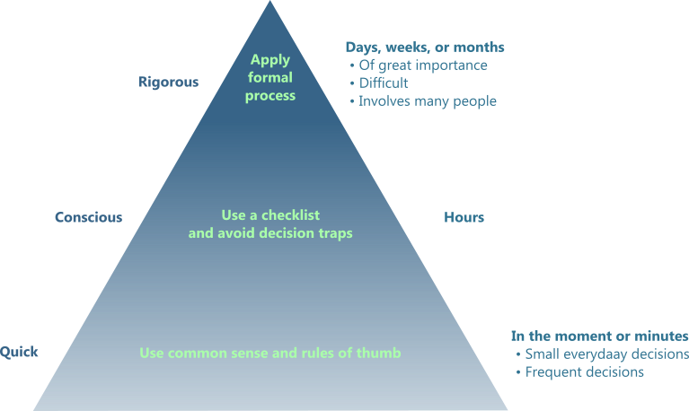

# prisma-decision-docs

"A decision is a choice between two or more alternatives that involves an irrevocable allocation of resources."[^1]

Decisions are the only way we can change our future life and for a company the basis to create value. Decisions are taken every day, some are simple and routine, while others can be difficult and with strong impact. Having different levels of complexity, dynamic, and consequences, decisions thus require different analysis process. The figure (taken from [^1]) below illustrates this idea.

<br>
<p align="center">

</p>
<br>
<p align="center">
<em>Hierarchy of decisions showing the relationship between the complexity <br>of the decision, the required process and its required time.</em>
</p>


prisma-decision aims at helping problems located at the top of the pyramid, meaning following a rigorous normative decision-making process. It aims at reproducing the framework described in Bratvold and Begg (2010):

"A scalable decision-making framework broadly applicable to most decision situations: with or without uncertainty, multi-objective or single objective, single decision or linked decisions, personal or business. (...) Its principles can be applied to analyses that span a range of times from less than an hour to months or years."[^2]


## Application for decision analysis and decision quality

Making good decisions is challenging, among others due to
- Bias
- Lack of clarity
- Lack of decision-making culture
- Not innate process

Decision analysis can be seen as a dialogue between the [decision makers and the analysts](./domain/decision_roles.md), aiming first at providing insight and clarity. Decision makers can then choose the best course of action[^2].

prisma-decision is an application that follows the principles of [decision analysis (DA)](./domain/decision_analysis.md) and of [decision quality (DQ)](./domain/decision_quality.md). It is designed as a collaborative tool and consists of

1. A frontend enabling
    - Framing the decision opportunity
    - Structuring the decision model
    - Evaluating the decision model
1. A Backend enabling
    - Accessing all the decision data in a database
    - Computations on the decision models


On the computational part, the decision model is expressed as an [influence diagram](./domain/influence_diagram.md) which is solved using the [pyagrum package](./domain/pyagrum.md). The influence diagram can be converted into a [decision tree](./domain/decision_tree.md) for interpretation purpose.
 

## Documentation

### Structure

| User question           |  Folder          | 
|-------------------------|------------------| 
| How do I do?            |  workflow        | 
| What does this mean?    |  domain          | 
| Why won't it work?      |  troubleshooting |
| How are figures made?   |  tools           |


### Workflow

1. Define Decision Context
1. Define Objectives
1. Raise and structure Issues
1. Develop a strategy table
1. Build and solve an Influence Diagram
1. Convert an Influence Diagram into a Decision Tree
1. Assess Decision Quality

### Concepts

- Decision Analysis
- Opportunity
- Objectives
- Issues
- Strategies
- Influence Diagram
- Decision Tree
- Decision Quality

### Troubleshooting

- Invalid Model


## Automatic figure making

The screenshots used in the how-to pages (`workflow/figures/`) are not taken by hand. The scripts in [tools/](./tools/README.md) run the Prisma web app and API locally, load an example project, and capture every page of the web app. Re-run them whenever the web app changes so the documentation stays in sync.

### Requirements

- Docker (with Compose), Node.js 20+, git, `python3`
- Network access to GitHub, Docker Hub and npm on the first run

No Equinor login is needed: the app runs in *Research* mode with a local SQLite database.

### Run

```bash
tools/setup.sh              # 1. clone or update web/API sources, start everything
node tools/capture.mjs      # 2. import the example project, capture all pages
tools/setup.sh stop         # 3. optional: stop the local services
```

The first `setup.sh` takes a few minutes (Docker images, npm packages, headless Chromium). Later runs take a few seconds and only redo what changed. `capture.mjs` imports the project export found in `workflow/projects/`, screenshots each page into `workflow/figures/<page>/`, removes the imported project again, and records the captured web/API versions in `workflow/figures/versions.json`.

### Check whether figures are outdated

```bash
tools/setup.sh check        # fetch upstream, compare with the versions the figures were made from
```

It reports how many commits the web app and API have gained since the last capture; if there are any, run `tools/setup.sh` and `node tools/capture.mjs` again and commit the updated figures.

### Conventions

- One folder per web app page: `workflow/figures/<page>/` (e.g. `issues`, `influence_diagram`, `assessments`), see the page list in [tools/pages.mjs](./tools/pages.mjs).
- File names follow `<element> - <description>.png`, e.g. `page - Issues.png`, `button - Create Assessment.png`, `popup - Create Assessment.png`.
- The example project is a Prisma export (JSON) stored in `workflow/projects/`. Pass another one with `node tools/capture.mjs --project <file>`.
- Options such as `--pages issues,strategies`, `--theme dark` or `--viewport 1920x1080` are described in [tools/README.md](./tools/README.md).


## Related Repositories

- [prisma-decision-api](https://github.com/equinor/prisma-decision-api) - Backend API
- [prisma-decision-web](https://github.com/equinor/prisma-decision-web) - Frontend application


## Citing

Hanea, R., Muller, T., Alerini, M., Bellout, M., and Chitan D., 2026, Structured Decision Analysis for Complex Decisions: Insights from Pilot Studies, European Association of Geoscientists & Engineers, ECMOR 2026, Sep 2026, Volume 2026, p.1 – 16, DOI: https://doi.org/10.3997/2214-4609.202637015


## Licence

 
## References

[^1]: Howard R. A. and Abbas A. E. (2016). Foundations of Decision Analysis. Pearson Education 2016.

[^2]: Bratvold, R. B. and Begg, S. (2010). Making Good Decisions, Society of Petroleum Engineers,  DOI: https://doi.org/10.2118/9781555632588, ISBN electronic: 978-1-61399-948-6.
