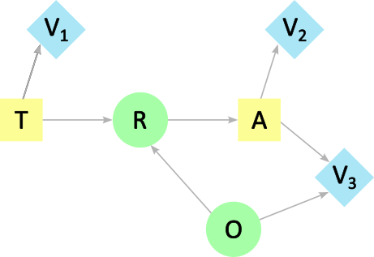

# Influence diagrams

## What is an influence diagram?

An influence diagram (ID) is a compact representation of a decision problem. It shows the choices 
under the decision maker's control, the uncertainties that matter, the information available when 
each choice is made, and how the consequences are valued[^1][^2]. It is a model of the decision, 
not a prediction of what will happen. 

The diagram consists of **nodes** connected by directed arrows, also called **arcs**. An arrow's meaning depends on the type of node it points to. The diagram describes the structure; it does not by itself specify the probabilities, values, or preferred decisions. These must also be assessed. An ID can represent many paths that a [decision tree](./decision_tree.md) displays separately.

A classical ID is usually required to satisfy five structural constraints: the graph has no directed cycles, there is a single value node, the value node has no outgoing arrows, the decisions are totally ordered, and the decision maker does not forget earlier decisions and observations. These define the classical single-decision-maker, no-forgetting formulation; extensions such as [LIMIDs](./limid.md) relax some of them, which changes how an absent arrow is interpreted. Each constraint is discussed in [Assumptions of classical influence diagrams](./influence_diagram_assumptions.md).

## Nodes and terminology

### Node types

| Node type | Other common terms | Conventional shape | Meaning |
|---|---|---|---|
| **Decision node** | Decision variable, action node | Rectangle | A choice under the decision maker's control. Its states are the available **options** or **alternatives**. |
| **Uncertainty node** | Chance node, random variable or random node | Oval | A quantity or event whose **outcome** is uncertain when modeled. Its probabilities describe the uncertainty, not a choice. |
| **Utility node** | Value node | Diamond | A numerical measure of the desirability of consequences, as a function of its parent nodes. It expresses why an alternative is more desirable than another. |

### Deterministic nodes and value scales

A deterministic quantity is sometimes shown as a special kind of uncertainty node: its value is fixed once its inputs are known. A value is not necessarily money. If monetary consequences are used directly as utility, the model ranks alternatives by expected monetary value; this corresponds to risk-neutral preferences for money. A utility scale may instead represent risk preferences, provided it has been assessed for that purpose[^3].

### Mathematical definition

Mathematically, while decision nodes and uncertainty nodes represent variables, utility nodes represent functions. Influence diagrams are extensions of Bayesian networks (BN), which only contain random nodes (uncertainties)[^2][^4][^5][^6]. The following definition is standard[^5][^7][^8].

An influence diagram is a directed acyclic graph (DAG) $G = (N, E)$ whose node set is partitioned into three disjoint sets, $N = \mathcal{C} \cup \mathcal{D} \cup \mathcal{V}$, and whose structure is quantified as follows.

- **Uncertainty nodes** $X \in \mathcal{C}$ are random variables with a finite set of states $\Omega_X$. Each is associated with a conditional probability distribution $P(X \mid \mathrm{pa}(X))$, where $\mathrm{pa}(X)$ denotes the parents of $X$. This is the BN part of the model.
- **Decision nodes** $D \in \mathcal{D}$ are variables with a finite set of options $\Omega_D$. They carry no probability distribution. The parents $\mathrm{pa}(D)$ are the variables observed when $D$ is decided.
- **Utility nodes** $V \in \mathcal{V}$ have no children and no states. Each is associated with a real-valued function $u_V : \Omega_{\mathrm{pa}(V)} \to \mathbb{R}$. The total utility is the sum $U = \sum_{V \in \mathcal{V}} u_V$; this additivity is what allows several utility nodes to stand in for the single value node of the classical formulation (see [utility separability](./utility_separability.md)).

In the used car buyer example below, $\mathcal{D} = \{T, A\}$, $\mathcal{C} = \{O, R\}$, $\mathcal{V} = \{V_1, V_2, V_3\}$, $\mathrm{pa}(R) = \{T, O\}$, $\mathrm{pa}(A) = \{R\}$, and $\mathrm{pa}(V_3) = \{A, O\}$.

Following the LIMID literature[^7][^9][^10], a **policy** for a decision $D$ is a function $\delta_D : \Omega_{\mathrm{pa}(D)} \to \Omega_D$ that selects an option for every configuration of what is observed, and a **strategy** is a set $q = \{\delta_D : D \in \mathcal{D}\}$ containing one policy per decision. Fixing a strategy turns every decision into a deterministic variable, so the influence diagram defines a joint distribution over all variables, exactly as a Bayesian network does:

$$
P_q(\mathcal{C}, \mathcal{D}) = \prod_{X \in \mathcal{C}} P(X \mid \mathrm{pa}(X)) \prod_{D \in \mathcal{D}} \mathbf{1}\left[D = \delta_D(\mathrm{pa}(D))\right].
$$

The expected utility of the strategy is

$$
\mathrm{EU}(q) = \sum_{\mathcal{C}, \mathcal{D}} P_q(\mathcal{C}, \mathcal{D}) \sum_{V \in \mathcal{V}} u_V(\mathrm{pa}(V)),
$$

and an **optimal strategy** $q^*$ is one that maximizes $\mathrm{EU}(q)$ over all strategies; its value is the **maximum expected utility** (MEU). Solving an influence diagram means finding $q^*$ and the MEU.

The same construction appears outside the LIMID literature under other names. Koller and Friedman define a *strategy* as a set of *decision rules* and evaluate it through the Bayesian network it induces[^8]; Poole and Mackworth define the expected utility of a *policy* as the probability-weighted sum of utility over the possible worlds that satisfy it[^2]; Jensen and Nielsen use *policy* and *strategy* as here[^5]. The classical papers[^1][^6] do not state the strategy-level expectation explicitly but evaluate the diagram decision by decision, as in the recursion below.

For a classical ID whose decisions are ordered $D_1 \prec \dots \prec D_n$, let $W_1$ be the uncertainties observed before $D_1$, $W_{i+1}$ those observed between $D_i$ and $D_{i+1}$, and $W_{n+1}$ those never observed; these are the decision windows of the [partial order](./partial_order.md) $W_1 \prec D_1 \prec W_2 \prec \dots \prec D_n \prec W_{n+1}$. Under no forgetting, the MEU is obtained by alternating sums and maximizations from the last decision backwards[^5][^6]:

$$
\mathrm{MEU} = \sum_{W_1} \max_{D_1} \sum_{W_2} \max_{D_2} \cdots \max_{D_n} \sum_{W_{n+1}} P(\mathcal{C} \mid \mathcal{D}) \sum_{V \in \mathcal{V}} u_V(\mathrm{pa}(V)),
$$

where $P(\mathcal{C} \mid \mathcal{D}) = \prod_{X \in \mathcal{C}} P(X \mid \mathrm{pa}(X))$. Each maximization yields the optimal policy for that decision as a function of everything observed before it. The worked example below carries out this calculation by hand; algorithms such as arc reversal and node removal[^6] or variable elimination[^2] perform it on the graph.

## Reading the arrows

The **parent** of a node is a node with an arrow directly into it. The parent and arrow have different interpretations depending on the destination[^2]:

- **Into an uncertainty:** a *conditional* or probabilistic dependency. For example, `Weather -> Forecast` means that the probabilities for a forecast are specified conditional on the weather. It does not mean the forecast causes the weather. Typically, if the parent is also an uncertainty, it expresses the conditional probability, such as $P(\text{Forecast} \mid \text{Weather})$.
- **Into a decision:** an *information* link. `Forecast -> Activity` means the forecast is available when the activity is chosen, so the choice may depend on it. It does not mean that the forecast physically causes the choice.
- **Into a utility:** a *functional* dependency. `Weather -> Satisfaction` means the value attributed to satisfaction may depend on the weather. A value table specifies the contribution for each combination of its parents' states.

An arrow indicates a modeled direct dependency or available information, not necessarily a causal relationship or a strong effect. Conversely, omitting a relevant arrow is a substantive modeling assumption: for example, an uncertainty's probability table then does not condition directly on that node. *Absence of a direct arrow does not, by itself, imply that two nodes are independent; they may still be related through other paths.*

In particular, an uncertainty affecting the outcome is not automatically known when a decision is made. Draw an information arrow into the decision only when the information is actually available then. The placement of nodes on the page does not itself establish timing.

## A worked example

Consider the classic used car buyer problem[^11]. A buyer is offered a used car. The car may be in good condition (a *peach*) or have hidden defects (a *lemon*), and its true state is not known to the buyer. Before deciding whether to buy, the buyer may pay for a mechanical test. The influence diagram is shown below.

 

*Influence diagram of the used car buyer problem. T is the decision of testing or not, A is the decision of purchasing, R is the result of the test, O is the initial state of the car, and V1, V2, and V3 are the cost of the test, the profit of the car and the maintenance costs.*

The diagram has seven nodes:

- **T**: decision, test or no test.
- **R**: uncertainty, the result of the test, either pass or fail; it is *no result* when no test is performed.
- **A**: decision, buy or do not buy.
- **O**: uncertainty, the initial state of the car, either peach or lemon.
- **V1**: utility, the cost of the test, depending on T.
- **V2**: utility, the profit of the car, depending on A.
- **V3**: utility, the maintenance costs, depending on A and O.

Reading the arrows: `O -> R` and `T -> R` are conditional dependencies, since the probabilities of the result depend on the state of the car and on whether a test is made at all. `R -> A` is an information link: the result is known when the purchase decision is made. `T -> V1`, `A -> V2`, `A -> V3` and `O -> V3` are functional dependencies. There is deliberately no `O -> A` information arrow: the buyer cannot observe the true state of the car when choosing. Under the [no-forgetting assumption](./influence_diagram_assumptions.md), the earlier decision T is also known at A. The total utility is the sum (over the states) $V_1 + V_2 + V_3$ (see [utility separability](./utility_separability.md)).

For illustration, suppose the prior probability of a peach is 0.8 and of a lemon 0.2. If a test is made, it passes with probability 0.9 for a peach and 0.4 for a lemon; the failure probabilities are the complements, 0.1 and 0.6. If no test is made, R is *no result* with probability 1 whatever the state of the car. Each conditional distribution sums to 1. The utilities are

| V1 | Test | No test |
|---|---:|---:|
| | -20 | 0 |

| V2 | Buy | Do not buy |
|---|---:|---:|
| | 200 | 0 |

| V3 | Peach | Lemon |
|---|---:|---:|
| Buy | -50 | -500 |
| Do not buy | 0 | 0 |

These are illustrative values and not the original ones (where the case was more complex).

**Solving the diagram.** The goal is to find the strategy with the highest expected utility: a policy for T (test or not) and a policy for A (buy or not, for each possible test result). Following the [recursion](#mathematical-definition) of the mathematical definition, the decisions are evaluated from the last one backwards. Decision A is settled first for each possible result R, because when A is made the result is known; then T is settled by comparing the expected utility of testing, averaged over the possible results, with the expected utility of not testing. This is the same order of operations as rolling back a [decision tree](./decision_tree.md).

*Branch without a test.* If T = no test, the result is *no result* and gives no information, so the buyer must decide A with the prior probabilities 0.8 and 0.2. Buying has expected utility $200 - 0.8 \times 50 - 0.2 \times 500 = 60$ (profit minus expected maintenance), not buying has 0. The best policy for A on this branch is to buy, and the branch is worth 60.

*Branch with a test.* If T = test, the result will be known at A, so the policy for A may differ for a pass and for a fail. Two quantities are needed, and neither is given directly in the tables because the probabilities were assessed in the direction $O \to R$, not $R \to O$.

- *How likely is each result?* A pass occurs with probability $P(\text{pass}) = 0.8 \times 0.9 + 0.2 \times 0.4 = 0.8$, and a fail with probability 0.2. These are needed to average over the results when evaluating T.
- *What does each result say about the car?* By Bayes' theorem, the probability of a peach given a pass is $(0.8 \times 0.9) / 0.8 = 0.9$, and given a fail it is $(0.8 \times 0.1) / 0.2 = 0.4$. These updated probabilities are what the buyer must use at A, since O is still unobserved there. This is the [arc reversal](./id_to_dt_arc_reversal.md) $O \to R$ to $R \to O$ done by hand.

Now A can be settled for each result. After a pass, buying has expected utility $200 - 0.9 \times 50 - 0.1 \times 500 = 105$, which beats 0, so buy. After a fail, buying has $200 - 0.4 \times 50 - 0.6 \times 500 = -120$, which is worse than 0, so do not buy. The policy for A on this branch is therefore *buy if pass, do not buy if fail*. Averaging over the results and adding the test cost, the branch is worth $-20 + 0.8 \times 105 + 0.2 \times 0 = 64$.

*Settling T.* Testing is worth 64 and not testing 60, so the optimal policy for T is to test.

The optimal **strategy** is therefore to test, buy if the test passes, and not buy if it fails, with maximum expected utility 64. The computation also shows what the test is for: with the test, the buyer avoids buying the lemons that fail, which raises the expected utility before costs from 60 to $0.8 \times 105 = 84$. The test result is thus worth $84 - 60 = 24$, which exceeds its cost of 20; had the test cost more than 24, the optimal strategy would have been not to test and to buy. An expected utility is a probability-weighted average under the model, not a guaranteed result for a given car.

> [!NOTE]
> **Policy and strategy.** As in the [mathematical definition](#mathematical-definition) above, a **policy** is the decision rule for a *single* decision node: a function from the states of its information parents to an option, such as "buy if the test passes, otherwise do not buy" for A. A **strategy** is the set of policies for *all* decision nodes, here the pair (test; buy if pass, do not buy if fail). What is maximized is the expected utility of the strategy, hence *optimal strategy*. This follows the LIMID literature[^7] and Jensen and Nielsen[^5]; Koller and Friedman use *decision rule* and *strategy* in the same way[^8], and the decision-tree literature also calls a complete contingent plan a *strategy*[^12][^13]. The distinction matters for methods such as Single Policy Updating[^7], which optimize one policy at a time while holding the others fixed; see [LIMIDs](./limid.md). Terminology is not uniform, however: in the artificial intelligence tradition, Poole and Mackworth call the complete plan a *policy* and the rule at a single decision node a *decision function*[^2].

## Building a diagram: deciding where the arcs go

Listing the nodes is usually the easy part. The difficulty is deciding which arcs to draw, because the everyday word "influence" mixes up three different questions. 
- An arc into a decision answers *what is known at that time*; 
- An arc into an uncertainty answers *what changes its probabilities*; 
- An arc into a utility answers *what changes the value*. 

The procedure below, which starts from the temporal order of the decisions, asks one question at a time[^1][^14]. The used car buyer example is used throughout.

### 1. Define the nodes so that they pass the clarity test

Arcs cannot be decided for nodes that are vaguely defined, so the first step is to make every node precise. Howard's **clarity test**[^14] is a thought experiment for this: imagine a clairvoyant who knows every fact about the past and the future, but has no judgment of his own and will not interpret your words. A node passes the test if you could ask the clairvoyant "which state did this node take?" and he could answer without asking you what you mean.

For a decision, the question is "which option was chosen?"; for an uncertainty, "which state occurred?"; for a utility, "what number resulted?". In the used car buyer problem, "the car is in good condition" fails the test, because the clairvoyant would have to ask what *good* means. "The mechanic's test is passed" passes it, because the test either reports pass or fail. "The maintenance cost over the first year, in dollars" passes it; "the car is reliable" does not. If a node fails the test, rewrite it in terms of an observable event, a measurable quantity, or an explicit choice, until the clairvoyant could answer.

Precise definitions make the later questions answerable: whether a node is *known* when a decision is made, and whether learning it would *change the probabilities* of another node, can only be judged when both nodes are unambiguous. The test also helps to classify each node: it is a decision if the decision maker chooses its state, an uncertainty if the world resolves it, and a utility if it values the consequences. Finally, the options of a decision must be mutually exclusive, and so must the states of an uncertainty; the states must also cover all the cases the model needs.

### 2. Order the decisions in time and place the uncertainties in decision windows

Write the decisions in the order they will be made, $D_1 \prec D_2 \prec \dots$. Then, for each uncertainty, ask one question only: **when, if ever, will its outcome be known for certain?** Place it in the [decision window](./partial_order.md) between the decision made just before it is observed and the decision made just after; place it in the last window if it is never observed before the final decision. Information arcs now follow mechanically: every uncertainty in a window is a parent of the next decision, and under no forgetting earlier decisions and their information are also available later (these arcs are usually left implicit).

**Remark.** If the order of two decisions is not fixed, or if a decision exists only on some paths, see step 6.

In the used car buyer problem, $T \prec A$; the test result $R$ is known between $T$ and $A$, so $R \to A$; the state of the car $O$ is never observed before $A$, so there is no $O \to A$. 

> [!IMPORTANT] 
> The most common mistake at this step is to draw an arc into a decision because the uncertainty *matters* for the decision. Mattering is not the question; being *known* is. $O$ matters enormously for $A$, and there is still no arc. What matters is already captured by the rest of the diagram: $O$ reaches the value through $O \to V_3$, and the buyer learns about it indirectly through $O \to R \to A$. When the diagram is solved, every such path is followed, so an uncertainty influences the choice through the paths that connect it to the value and to the information, not through a direct arc into the decision.

### 3. Draw relevance arcs into uncertainties

For each uncertainty $Y$, ask about each other variable $X$ that comes before it or at the same time: **given everything else already drawn as a parent of $Y$, would learning $X$ change my probabilities for $Y$?** If yes, $X$ is *relevant* to $Y$ and gets an arc $X \to Y$[^15]. If no, leaving the arc out states a conditional irrelevance, which is a modeling claim worth saying aloud: "the probability of $Y$ does not depend on $X$ once I know the other parents".

- Between uncertainties, the direction of an arc is a choice of how the probabilities are assessed, not a claim about causation. Draw it in the direction that is easiest to assess, typically the causal or temporal direction; the reverse direction is obtained by [arc reversal](./id_to_dt_arc_reversal.md). $P(R \mid O)$, the chance that a peach passes the test, is easier to assess than $P(O \mid R)$, so draw $O \to R$.
- From a decision to an uncertainty, draw an arc only if the *choice itself changes the probabilities*. Choosing to test determines whether a result exists at all, so $T \to R$. Choosing to buy does not change the state of the car, so no $A \to O$. A standard illustration is an oil prospect: the choice to drill does not change whether oil is present, so there is no arc from the drilling decision to the oil uncertainty; the choice only changes the *value*, and that arc goes to the utility node.
- Do not draw an arc because $X$ affects the *consequences* through $Y$; that is a value relationship (step 4). $O$ affects how good a deal the car is, but that is modeled by $O \to V_3$, not by an arc from $O$ to anything else.

### 4. Draw arcs into utility nodes

For each utility node ask: **which decisions and uncertainties change this value?** Costs come from the decision that incurs them ($T \to V_1$ for the test fee). Payoffs come from the decision and from the uncertainties that determine the payoff ($A \to V_2$; $A \to V_3$ and $O \to V_3$). A variable that influences the value only through another variable already drawn as a parent does not need an arc; $R$ is not a parent of any utility node. Use several utility nodes for additively separable components, so that each table stays small and each parent set is easy to justify (see [utility separability](./utility_separability.md)).

### 5. From "if I do this, I can observe that, then do another thing" to influence and relevance

Many people naturally describe a problem as a sequence of branches: "if I test, I see the result, and then I decide; if I do not test, I just decide". That is a fragment of a [decision tree](./decision_tree.md), and it can be translated into influence diagram elements piece by piece:

| Decision-tree thinking | Influence diagram element |
|---|---|
| "If I do this…" | An option of a decision node. All branches at the same point in time belong to the *same* decision node, whatever the path that led there. |
| "…I can observe that…" | An uncertainty node placed in the window before the next decision, with an information arc into that decision. |
| "…and then do another thing." | The next decision node in the order. Earlier choices are known there under no forgetting. |
| "The odds of this event are different on that branch." | The variable that distinguishes the branches is a parent of the event. |
| "This event only happens if I chose that option." | This is [asymmetry](./asymmetry.md). For classical ID, this modelled by setting an extra state to the uncertainty such as *not observed* or *not applicable*, and the enabling decision is its parent, with probability 1 on the extra state when the option is not chosen[^16]. |
| "The payoff at the end of this path depends on…" | Arcs from exactly those variables into a utility node. The same utility node serves every path. |

The purpose of the translation is to stop reasoning path by path. A [decision tree](./decision_tree.md) repeats a variable on every path where it appears; an influence diagram holds it once and records how its probabilities and the available information depend on the rest. Once each variable is a single node, the three questions of steps 2 to 4 settle the arcs.

**Asymmetric problems in classical IDs.** The following applies to a classical influence diagram, in which every decision and uncertainty is present on every path. When some decisions and uncertainties exist only after certain options have been chosen, the temporal order is still usable. Order the decisions as they would occur on the *longest* path, and give each decision that may not occur a *not applicable* option whose utility contribution is zero; give each uncertainty that may not be observed a *not observed* state conditioned on the enabling decision, as $R$ is on $T$ above[^16]. The policy for a skipped decision is then trivially *not applicable*, and no path is lost. When an earlier choice makes some options of a later decision infeasible, the infeasible combinations can be given a very large negative utility (an *infinite cost*), so that no optimal strategy ever selects them; the utility node then needs the enabling decision as a parent. These encodings enlarge the tables with impossible combinations that must be filled consistently; see [asymmetry](./asymmetry.md) for their limits. When the *order itself* depends on earlier choices, for example when the decision maker chooses which of two inspections to perform first, a single fixed order no longer describes the problem, and several diagrams may be needed[^17].

**Extensions for asymmetry.** Several representations extend influence diagrams so that asymmetry is expressed in the graph rather than in the tables. In particular, **decision analysis networks** (DANs)[^18] do not require a total order of the decisions and let the existence of a variable or the availability of an option depend on the states of other variables, using *restriction* and *revelation* links; unconstrained influence diagrams[^19] and sequential influence diagrams address the case where the order of decisions is itself a choice. These are discussed in [asymmetry](./asymmetry.md).

## Advantages and limitations

**Advantages**

- An ID gives a compact overview of decisions, information, uncertainties, and objectives. It can share dependencies across many paths that a decision tree would show separately[^17].
- Arrows make assumptions about probability, available information, and value dependencies easier to discuss and review. The model can also expose conditional independencies that an evaluation method may exploit.
- An evaluated ID can identify a [strategy](#mathematical-definition), that is a policy for each decision given its available observations, and support comparisons of alternatives or information, given assessed probabilities and utilities.

**Limitations**

- A compact graph can hide large probability and utility tables, strong assumptions, and the details of individual paths. A decision tree may be easier to inspect for a small, highly contingent problem[^17].
- Results depend on the chosen variables, information assumptions, probabilities, utility scale, and available options. Missing or poorly assessed inputs can lead to misleading recommendations.
- Conventional IDs do not display [asymmetries](./asymmetry.md) naturally: which options exist, what can be observed, or the order of choices may depend on the situation. Additional modeling or a more expressive representation may be needed[^17].
- Evaluation can become computationally expensive as the model and its dependencies grow. A classical no-forgetting, fixed-order formulation may also be unsuitable when actual information or timing differs.

## See also

- [Decision trees](./decision_tree.md)
- [Assumptions of classical influence diagrams](./influence_diagram_assumptions.md)
- [Limited-memory influence diagrams](./limid.md)
- [Asymmetry in decision problems](./asymmetry.md)
- [Utility separability](./utility_separability.md)
- [Arc reversal in ID to decision-tree conversion](./id_to_dt_arc_reversal.md)

## References

[^1]: Howard, R. A. and Matheson, J. E. (2005). *Influence Diagrams*. Decision Analysis, 2(3), 127-143. [https://doi.org/10.1287/deca.1050.0020](https://doi.org/10.1287/deca.1050.0020).

[^2]: Poole, D. L. and Mackworth, A. K. (2023). *Artificial Intelligence: Foundations of Computational Agents*, 3rd ed., section 12.3, Sequential Decisions. Cambridge University Press. [Open textbook](https://www.cs.ubc.ca/~poole/aibook/3e/html/ArtInt3e.Ch12.S3.html).

[^3]: Poole, D. L. and Mackworth, A. K. (2023). *Artificial Intelligence: Foundations of Computational Agents*, 3rd ed., section 12.1, Preferences and Utility. Cambridge University Press. [Open textbook](https://www.cs.ubc.ca/~poole/aibook/3e/html/ArtInt3e.Ch12.S1.html).

[^4]: Pearl, J. (1988). *Probabilistic Reasoning in Intelligent Systems: Networks of Plausible Inference*. Morgan Kaufmann. ISBN 1-55860-479-0.

[^5]: Jensen, F. V. and Nielsen, T. D. (2007). *Bayesian Networks and Decision Graphs*, 2nd ed., chapter 9, Graphical Languages for Specification of Decision Problems. Springer. [https://doi.org/10.1007/978-0-387-68282-2](https://doi.org/10.1007/978-0-387-68282-2).

[^6]: Shachter, R. D. (1986). *Evaluating Influence Diagrams*. Operations Research, 34(6), 871-882. [https://doi.org/10.1287/opre.34.6.871](https://doi.org/10.1287/opre.34.6.871).

[^7]: Lauritzen, S. L. and Nilsson, D. (2001). *Representing and Solving Decision Problems with Limited Information*. Management Science, 47(9), 1235-1251. [https://doi.org/10.1287/mnsc.47.9.1235.9779](https://doi.org/10.1287/mnsc.47.9.1235.9779).

[^8]: Koller, D. and Friedman, N. (2009). *Probabilistic Graphical Models: Principles and Techniques*, chapter 23, Structured Decision Problems. MIT Press. ISBN 978-0-262-01319-2.

[^9]: Nilsson, D. and Lauritzen, S. L. (2000). *Evaluating Influence Diagrams using LIMIDs*. Proceedings of the 16th Conference on Uncertainty in Artificial Intelligence, 436-445. [Open paper](https://arxiv.org/abs/1301.3881).

[^10]: Mauá, D. D., de Campos, C. P. and Zaffalon, M. (2012). *Solving Limited Memory Influence Diagrams*. Journal of Artificial Intelligence Research, 44, 97-140. [https://doi.org/10.1613/jair.3625](https://doi.org/10.1613/jair.3625); [open preprint](https://arxiv.org/abs/1109.1754).

[^11]: Howard, R. A. (1962). *The Used Car Buyer*. Reprinted in Howard, R. A. and Matheson, J. E. (eds.) (1983), *Readings on the Principles and Applications of Decision Analysis*, Vol. II. Strategic Decisions Group, Menlo Park, CA.

[^12]: Raiffa, H. (1968). *Decision Analysis: Introductory Lectures on Choices under Uncertainty*. Addison-Wesley.

[^13]: Clemen, R. T. and Reilly, T. (2014). *Making Hard Decisions with DecisionTools*, 3rd ed. Cengage Learning. ISBN 978-0-538-79757-3.

[^14]: Howard, R. A. (1988). *Decision Analysis: Practice and Promise*. Management Science, 34(6), 679-695. [https://doi.org/10.1287/mnsc.34.6.679](https://doi.org/10.1287/mnsc.34.6.679).

[^15]: Howard, R. A. (2004). *Speaking of Decisions: Precise Decision Language*. Decision Analysis, 1(2), 71-78. [https://doi.org/10.1287/deca.1030.0005](https://doi.org/10.1287/deca.1030.0005).

[^16]: Smith, J. E., Holtzman, S. and Matheson, J. E. (1993). *Structuring Conditional Relationships in Influence Diagrams*. Operations Research, 41(2), 280-297. [https://doi.org/10.1287/opre.41.2.280](https://doi.org/10.1287/opre.41.2.280).

[^17]: Bielza, C. and Shenoy, P. P. (1997). *A Comparison of Decision Trees, Influence Diagrams and Valuation Networks for Asymmetric Decision Problems*. Proceedings of the Sixth International Workshop on Artificial Intelligence and Statistics, 39-46. [Open paper](https://proceedings.mlr.press/r1/bielza97b.html).

[^18]: Díez, F. J., Luque, M. and Bermejo, I. (2018). *Decision Analysis Networks*. International Journal of Approximate Reasoning, 96, 1-17. [https://doi.org/10.1016/j.ijar.2018.02.007](https://doi.org/10.1016/j.ijar.2018.02.007); [open institutional record](https://hdl.handle.net/20.500.14468/12465).

[^19]: Jensen, F. V. and Vomlelova, M. (2002). *Unconstrained Influence Diagrams*. Proceedings of the 18th Conference on Uncertainty in Artificial Intelligence, 234-241. [Open paper](https://arxiv.org/abs/1301.0574).
