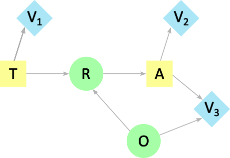

# Utility separability

## Super value nodes

A classical [influence diagram](./influence_diagram.md) has a single value node (see [assumptions](./influence_diagram_assumptions.md)). Tatman and Shachter relaxed this constraint with the concept of **super value nodes**: a value node whose parents are themselves value nodes, and which combines them by a fixed operation[^1]. Several value nodes can then represent the separable structure of the value function. A value function $g(\mathbf{x})$ over the $n$ variables $\mathbf{x}$ is **separable** if

$$
g(\mathbf{x}) = \sum_{i=1}^{q} g_i(\mathbf{x}_i)
\qquad \text{or} \qquad
g(\mathbf{x}) = \prod_{i=1}^{q} g_i(\mathbf{x}_i),
$$

where each subvector $\mathbf{x}_i$ contains a subset of the components of $\mathbf{x}$[^1]. Each component $g_i$ becomes a value node whose parents are exactly the variables in $\mathbf{x}_i$, and the super value node is the sum or the product of its parents. In most diagrams, and in most software, the super value node is left implicit: the diagram simply shows several terminal utility nodes and the convention is that they are added.

The benefit is twofold. Each component table is assessed over its own parents only, instead of one table over the union of all parents; and the solution algorithms can exploit the decomposition, since a sum or a product can be processed component by component when variables are eliminated[^1].

## Additive form

The common case is the sum[^2]:

$$
U(x) = U_1(x_{P_1}) + U_2(x_{P_2}) + \cdots + U_k(x_{P_k}),
$$

where $x_{P_i}$ denotes the states of the parents of component $i$. To recover the single-value representation, compute the sum for each combination of the union of their parents. Linearity of expectation means that the expected total is the sum of the expected contributions; the uncertainties themselves need not be independent.

In the [used car buyer example](./influence_diagram.md#a-worked-example), the total value is $V_1 + V_2 + V_3$: the test cost depends only on $T$, the profit only on $A$, and the maintenance cost on $A$ and $O$. A single value node would need all of $T$, $A$ and $O$ as parents, with a table of $2 \times 2 \times 2$ entries each of which repeats the same additions. The three component tables have 2, 2 and 4 entries.

## Multiplicative form

The product form arises in two common situations.

- **Risk aversion over an additive monetary value.** If the decision maker's utility for money is exponential, $u(m) = -e^{-m/\rho}$ with risk tolerance $\rho$, and the monetary value is a sum of components $m = m_1 + \cdots + m_k$, then $u(m) = -\prod_i e^{-m_i/\rho}$. An additive cash-flow model therefore becomes a multiplicative utility model once this risk attitude is applied. Other utility functions, such as logarithmic or power utilities, do not factorize over a sum and require the total to be formed first (see below).
- **Multiattribute utility.** When preferences over several attributes satisfy mutual utility independence, the multiattribute utility has the multiplicative form $1 + K\,u(x) = \prod_i \left(1 + K k_i u_i(x_i)\right)$ with scaling constants $k_i$ and $K$[^3]. This reduces to the additive form when $\sum_i k_i = 1$.

Unlike the sum, the expectation of a product is not in general the product of the expectations, since the components may share uncertain parents. The algorithms of Tatman and Shachter handle this by combining the component nodes that share an eliminated variable before the elimination[^1]; the product structure is still exploited wherever components depend on different variables.

## More general aggregation functions

Can the components be combined by a function other than a sum or a product, for example a maximum, a threshold, or a nonlinear transform of the total? Any aggregation $g = h(g_1, \ldots, g_q)$ can be *represented*: add a deterministic node for each component, a deterministic node for $h$, and a single utility node reading $h$. Whether it can be *exploited* is another matter. Elimination algorithms work because the operation combining the components distributes over the expectation and the maximization: $\mathbb{E}[\sum_i g_i] = \sum_i \mathbb{E}[g_i]$ always, and a product factorizes over variables that appear in only one component. Most other operations do not have this property; for example $\mathbb{E}[\max(g_1, g_2)] \ne \max(\mathbb{E}[g_1], \mathbb{E}[g_2])$. For such an aggregation, the solver must effectively form the table of $h$ over the union of the components' parents, which is the single-value-node computation that separability was meant to avoid.

In practice, therefore:

- Use several utility nodes when the components add (or multiply, if the software supports it).
- When the aggregation is nonlinear, compute it in a deterministic node and attach one utility node to it; expect the table of that node to be large.
- Apply a nonlinear utility function (risk attitude) to the *total* monetary value, not to each component separately, unless the utility function is exponential.

Software support differs. pyAgrum, used by prisma-decision, combines utility nodes by addition only[^4]; a multiplicative or more general structure must be expressed through deterministic nodes as described above.

## Conditions for a meaningful decomposition

This decomposition is an **assumption about the value function**, not something that follows automatically from separate objectives. Components must use a consistent, appropriately weighted utility scale; adding unrelated scores or independently normalized utilities does not automatically produce a meaningful total. Additive separability of individual attributes can fail when their combined effect depends on an interaction. In the used car buyer example, the maintenance cost depends jointly on buying and on the state of the car: a separate purchase-only term plus a state-only term cannot represent it, which is why $V_3$ has both $A$ and $O$ as parents. A joint table with both parents represents the interaction, or an explicitly assessed interaction term can be added. Do not count the same benefit or cost in more than one component.

 

*Influence diagram of the used car buyer problem. T is the decision of testing or not, A is the decision of purchasing, R is the result of the test, O is the initial state of the car, and V1, V2, and V3 are the cost of the test, the profit of the car and the maintenance costs.*

## See also

- [Influence diagrams](./influence_diagram.md)
- [Assumptions of classical influence diagrams](./influence_diagram_assumptions.md)
- [Limited-memory influence diagrams](./limid.md)
- [pyAgrum](./pyagrum.md)

## References

[^1]: Tatman, J. A. and Shachter, R. D. (1990). *Dynamic Programming and Influence Diagrams*. IEEE Transactions on Systems, Man, and Cybernetics, 20(2), 365-379. [https://doi.org/10.1109/21.52548](https://doi.org/10.1109/21.52548).

[^2]: Poole, D. L. and Mackworth, A. K. (2023). *Artificial Intelligence: Foundations of Computational Agents*, 3rd ed., section 12.1, Preferences and Utility. Cambridge University Press. [Open textbook](https://www.cs.ubc.ca/~poole/aibook/3e/html/ArtInt3e.Ch12.S1.html).

[^3]: Keeney, R. L. and Raiffa, H. (1993). *Decisions with Multiple Objectives: Preferences and Value Tradeoffs*, chapter 6. Cambridge University Press. ISBN 978-0-521-43883-4.

[^4]: Ducamp, G., Gonzales, C., Wuillemin, P.-H. (2020). *aGrUM/pyAgrum: a Toolbox to Build Models and Algorithms for Probabilistic Graphical Models in Python*. International Conference on Probabilistic Graphical Models, Skørping, Denmark. [HAL](https://hal.science/hal-03135721v1).
