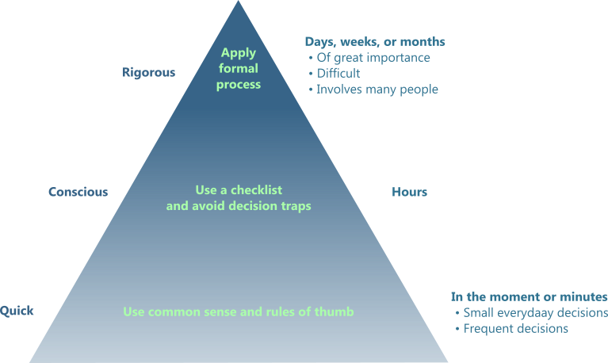

import { Card, CardGrid } from '@astrojs/starlight/components';

> "A decision is a choice between two or more alternatives that involves an irrevocable allocation of resources."[^1]

Decisions are the only way we can change our future life and for a company the basis to create value. Decisions are taken every day, some are simple and routine, while others can be difficult and with strong impact. Having different levels of complexity, dynamic, and consequences, decisions thus require different analysis processes. The figure (taken from [^1]) illustrates this idea.

prisma-decision aims at helping problems located at the top of the pyramid, meaning following a rigorous normative decision-making process. It aims at reproducing the framework described in Bratvold and Begg (2010):

<figure class="centered-figure">

<figcaption>Hierarchy of decisions showing the relationship between the complexity of the decision, the required process and its required time.</figcaption>

</figure>

> "A scalable decision-making framework broadly applicable to most decision situations: with or without uncertainty, multi-objective or single objective, single decision or linked decisions, personal or business. (...) Its principles can be applied to analyses that span a range of times from less than an hour to months or years."[^2]

## Application for decision analysis and decision quality

Making good decisions is challenging, among others due to bias, lack of clarity, lack of decision-making culture, and because it is not an innate process.

Decision analysis can be seen as a dialogue between the [decision makers and the analysts](./methodology/technical_notes/decision_roles.md), aiming first at providing insight and clarity. Decision makers can then choose the best course of action[^2].

<CardGrid stagger>
	<Card title="Decision analysis" icon="open-book">
		prisma-decision follows the principles of [decision analysis (DA)](./methodology/technical_notes/decision_analysis.md) and [decision quality (DQ)](./methodology/technical_notes/decision_quality.md).
	</Card>
	<Card title="Influence diagrams" icon="seti:graphql">
		The decision model is expressed as an [influence diagram](./methodology/technical_notes/influence_diagram.md) which is solved using the [pyagrum package](./methodology/technical_notes/pyagrum.md).
	</Card>
	<Card title="Decision trees" icon="list-format">
		The influence diagram can be converted into a [decision tree](./methodology/technical_notes/decision_tree.md) for interpretation purposes.
	</Card>
	<Card title="Collaborative tool" icon="setting">
		A [frontend](https://github.com/equinor/prisma-decision-web) for framing, structuring and evaluating decision models, and a [backend](https://github.com/equinor/prisma-decision-api) storing decision data and running computations.
	</Card>
</CardGrid>

## References

[^1]: Howard R. A. and Abbas A. E. (2016). Foundations of Decision Analysis. Pearson Education 2016.

[^2]: Bratvold, R. B. and Begg, S. (2010). Making Good Decisions, Society of Petroleum Engineers, DOI: https://doi.org/10.2118/9781555632588, ISBN electronic: 978-1-61399-948-6.
