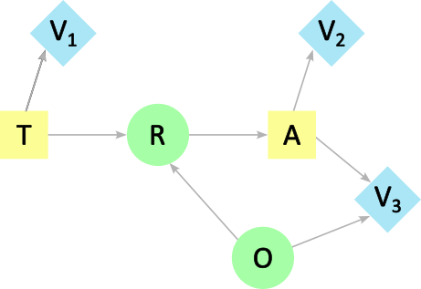

# Technical notes

Focused notes on the concepts, models and algorithms used by prisma-decision.
This file is only shown on GitHub; it is not part of the published documentation.

- [Decision analysis](./decision_analysis.md) — the formulation, evaluation and appraisal cycle
- [Decision quality](./decision_quality.md) — the six elements of a good decision
- [Roles in decision making](./decision_roles.md) — decision maker, expert, facilitator, analyst
- [Influence diagrams](./influence_diagram.md) — the graphical decision model used in prisma-decision
- [Limited memory influence diagrams (LIMID)](./limid.md)
- [Partial order](./partial_order.md) — ordering the nodes of an influence diagram
- [Arc reversal when converting an ID to a DT](./id_to_dt_arc_reversal.md)
- [Decision trees](./decision_tree.md)
- [pyagrum](./pyagrum.md) — the solver used by prisma-decision

## Conventions

### New documentation

Each note is a Markdown file in `src/content/docs/methodology/technical_notes/`
with a `title` in its frontmatter. The title is rendered as the top-level
heading, so all sections in the note should start with a header of level 2 (`##`).

Links between notes use relative paths to the Markdown files
(e.g. `[Influence diagram](./influence_diagram.md)`); they are rewritten to the
correct URLs when the site is built and stay browsable on GitHub.

References to papers should be linked to open-source access when possible.

### Figures

Figures live in `src/content/docs/methodology/technical_notes/figures/` and are
included with standard Markdown image syntax, followed by an italic caption
paragraph:

```md


*Influence diagram of the used car buyer problem.*
```

Conventions are required so figures are harmonized.

#### Font

Calibri, normal

#### Graphical representation of influence diagrams

- Decision nodes: square or rectangle with color #fdfd96ff
- Chance nodes: circle or ellipse with color #a6ffa6ff
- Value nodes: diamond with color #aae6f6ff
- Arc: arrow with color #b3b3b3ff
- Revelation line: arrow with color #d35f5fff
